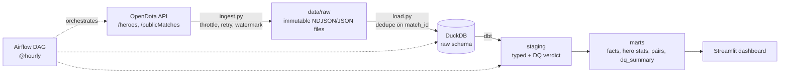

# Dota 2 Meta Pipeline

An end-to-end data pipeline for Dota 2 public ladder matches from the
[OpenDota API](https://docs.opendota.com/): incremental extraction, a raw landing
zone, a DuckDB warehouse, dbt models with data quality checks, Airflow
orchestration and a Streamlit dashboard answering *"which heroes are actually
strong, at which rank, and which pairs work together?"*

It runs **locally with no cloud account and no API key**. A built-in fake API lets
you run and test everything offline.

## Architecture



| Layer | Tool | Where |
|---|---|---|
| Extract | Python + requests | `src/dota_pipeline/ingest.py` |
| Load (raw) | Python + DuckDB | `src/dota_pipeline/load.py` |
| Transform + test | dbt-duckdb | `dbt_project/` |
| Orchestrate | Airflow | `airflow/dags/dota_dag.py` |
| Serve | Streamlit | `dashboard/app.py` |
| Offline demo | Fake OpenDota API | `src/dota_pipeline/mock_api.py` |
| CI | GitHub Actions | `.github/workflows/ci.yml` |

## Quick start

Requires **Python 3.10 to 3.13** (Python 3.12 recommended; check with `python3 --version`).
On macOS: `brew install python@3.12`, then use `make setup PYTHON3=python3.12`.
Run these one at a time (do not paste the `#` comments into zsh):

```bash
make setup        # creates .venv and installs everything
make sample       # offline demo on SYNTHETIC data; it runs twice to show incremental loading
make test
make dashboard    # opens http://localhost:8501
make run          # real OpenDota API (about 1 request/second)
```

`make` uses its own `.venv`, so you do not need to activate anything or have
`python`/`pip` on your PATH (macOS only ships `python3`).

Without `make` (after `source .venv/bin/activate`): `python -m dota_pipeline.run --pages 20` (real API) or
`python -m dota_pipeline.run --mock --mock-size 5000` (offline demo).

Optional: `export OPENDOTA_API_KEY=...` for higher rate limits.
Check the current free-tier limits at <https://www.opendota.com/api-keys>
(historically about 60 requests/minute); the client waits ~1.1 s between calls
(`OPENDOTA_MIN_INTERVAL`) and honours `Retry-After` on HTTP 429.

## Troubleshooting

- **`requires a different Python: 3.14...`**: dbt does not support Python 3.14 yet. Install 3.12 and run
  `rm -rf .venv && make setup PYTHON3=python3.12`.
- **`CERTIFICATE_VERIFY_FAILED` during install** (python.org installers on macOS): run
  `/Applications/Python\ 3.x/Install\ Certificates.command`, or use Homebrew's Python.
- **`command not found: python` / `pip`**: use `make` (it uses its own `.venv`), or `python3` / `pip3`.
- **zsh `unknown file attribute`**: you pasted a line that contains `# comments (with parentheses)`; paste commands only.

## Design decisions

**1. A real landing zone.** The API is a moving target, so the raw response is
stored as immutable files first (`public_matches/dt=YYYY-MM-DD/matches_<ts>.ndjson`)
and never edited. Files are written via `.part` + atomic rename and never overwritten.
You can always rebuild the warehouse from `data/raw`.

**2. Incremental extraction with a high-water mark.** `/publicMatches` returns
the newest ~100 matches and is paged backwards with `less_than_match_id`. The
pipeline stores the highest `match_id` it has seen and stops paging as soon as it
reaches it. The watermark only moves *after* the file is safely on disk, so a crash
cannot skip data. Running again with nothing new costs one API call and writes no file.

**3. Idempotent loads.** `match_id` is the natural key. Each file is loaded in one
transaction, de-duplicated inside the file and against the table, and recorded in
`raw.load_log`. Retries, overlapping runs and reprocessing are safe.

**4. API drift handled at the edge.** Team hero lists have been served both as arrays
and as `"1,2,3"` strings. `normalize_match()` converts both to integer arrays before
anything is written. Covered by tests.

**5. Bad data is flagged, not silently dropped.** `stg_public_matches` keeps every row
and assigns a `dq_failure_reason` (`invalid_team_size`, `duplicate_hero_in_match`,
`invalid_duration`, `invalid_start_time`, `missing_result`). Only valid matches reach
the facts; `dq_summary` reports what was rejected. Matches without a rank are kept
(they count in overall stats, but are excluded from per-rank stats).

**6. Statistics that don't lie.** A hero with 60% over 20 games is not better than one
with 54% over 3,000. `mart_hero_winrate` carries a Wilson 95% interval and the
dashboard sorts by its lower bound.

**7. Modeling for analytics.** `fct_matches` holds one row per match. `fct_match_heroes`
unnests both teams into one row per match x hero (10 per match), turning hero stats
and pair analysis into plain `GROUP BY`s. Both are incremental dbt models
(`delete+insert`, filtered on `_loaded_at`).

**8. Tests at three levels.** 20 Python tests (pagination, watermark, 429 retry, drift,
dedup, no-overwrite regression, and a real extract+load run against the mock API),
dbt generic tests, and dbt singular tests (every match has 10 heroes and exactly 5
winners; win rates and intervals are consistent).

## Data model

```
raw.public_matches ─► staging.stg_public_matches ─► marts.fct_matches ─► marts.fct_match_heroes ─┬► mart_hero_winrate
raw.heroes_snapshots ─► staging.stg_heroes ───────► marts.dim_heroes ──────────────────────────────┼► mart_hero_winrate_by_rank
reference.rank_tiers (seed)                                                                         ├► mart_hero_daily
                                  stg_public_matches ─► marts.dq_summary                            ├► mart_hero_pairs
                                  fct_matches ─► marts.mart_daily_matches                           └► (dashboard)
```

## Caveats

- `/publicMatches` is a **sample** of recent public matches, not every game. It only
  looks back a short window, so there is nothing to backfill: coverage depends on how
  often you run (the DAG is hourly). If more matches appear between runs than
  `--pages` allows, you get gaps; treat results as sample statistics.
- Patch/version is not in this endpoint, so `mart_hero_daily` is a trend proxy for
  balance changes, not a per-patch breakdown.
- The mock API generates **synthetic** matches (random hero strengths, deliberately
  dirty rows, legacy string formats). Use it for demos and CI only; its numbers say
  nothing about the real game.
- Dota 2 is a trademark of Valve. This project is not affiliated with Valve or OpenDota.

## Airflow

```bash
pip install -e ".[airflow]"
export PROJECT_ROOT=$(pwd) AIRFLOW__CORE__DAGS_FOLDER=$(pwd)/airflow/dags
airflow standalone
```
`max_active_runs=1` because DuckDB allows a single writer.

## Going to the cloud

| Local | Cloud equivalent |
|---|---|
| `data/raw` | S3 / GCS (keep the same `dt=` partitioning) |
| DuckDB | BigQuery / Snowflake (swap the dbt adapter; replace DuckDB-specific `unnest`, `list_distinct`, `make_timestamp`) |
| Airflow standalone | Cloud Composer / MWAA |
| Streamlit | Looker Studio / Metabase |

## Ideas for extension

- Enrich with `/matches/{id}` (items, lane roles, GPM/XPM) for a row per player.
- Add `/proMatches` for a pro-scene vs ladder meta comparison.
- Hero counters (`/heroes/{id}/matchups`) as another mart.
- dbt `source freshness` plus Slack/e-mail alerts on test failures.
- A streaming variant with Kafka for live match events.
